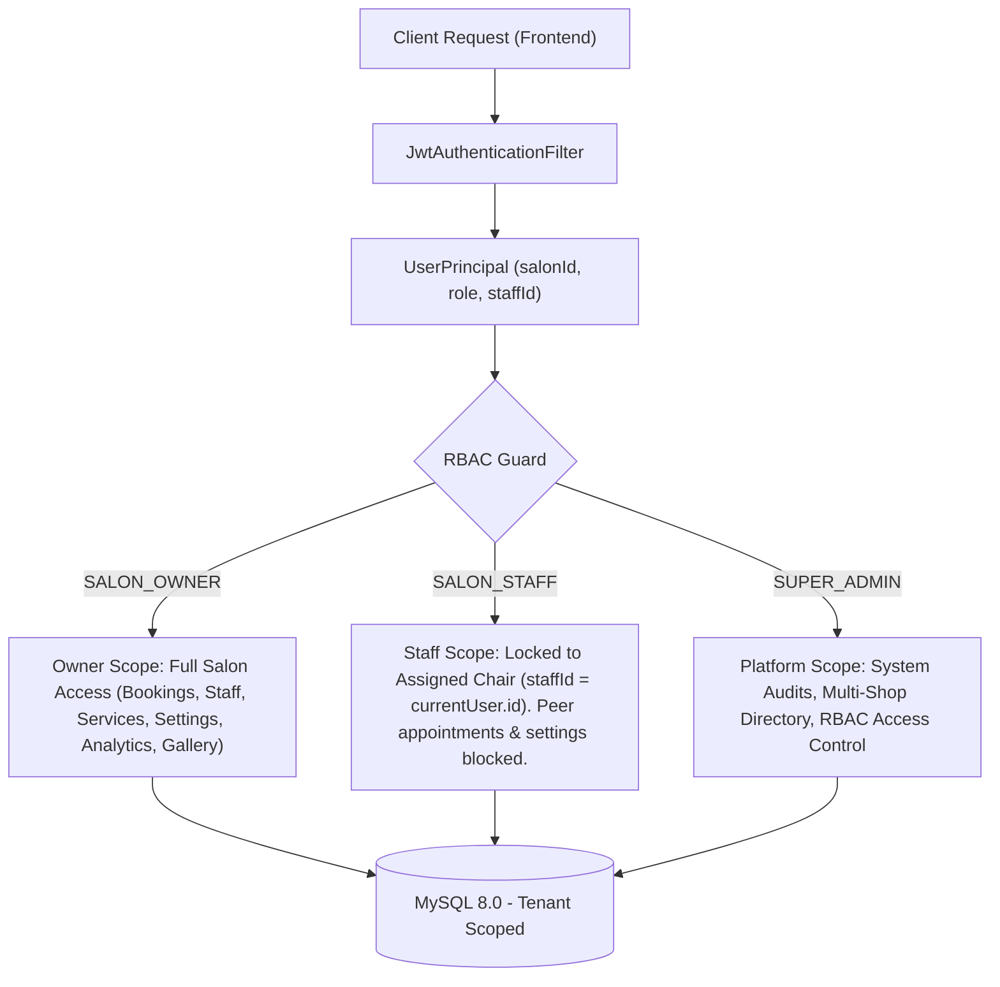

# System Architecture & Technical Specifications
## Salon & Barber Appointment SaaS Platform (BarberApp KSA)

---

## 1. Architectural Overview & Technology Stack

The platform is engineered as a multi-tenant SaaS appointment and salon operations system tailored for the Saudi Arabian retail grooming market.

### Core Stack Components:
- **Backend**: Spring Boot 3.3.4 (Java 21) on embedded Tomcat.
- **Database**: MySQL 8.0 with Flyway database migration management.
- **Cache & Concurrency**: Redis 7.0 with Redisson distributed locking.
- **Frontend Architecture**: Pure Vanilla JavaScript (ES Modules) + Tailwind CSS (v3 CDN) + semantic responsive HTML5. No React/Next.js/Node runtime dependencies.
- **Security & RBAC**: Stateless JWT Authentication (`/api/v1/auth/**`), Spring Security 6 filter chain, role-based method security, and tenant isolation decorators.
- **Real-Time Communication**: WebSocket STOMP Broker (`/ws`) for live appointment schedule synchronization.
- **Static Asset Subsystem**: Dedicated local disk storage mapping to `/uploads/**` with magic-byte validation and strict size bounds.

---

## 2. Multi-Tenant Isolation & Role-Based Access Control (RBAC)

The system enforces strict multi-tenant boundary isolation across all data access pathways.



### RBAC Matrix:
| Role | Portal Calendar | Quick Walk-in | Staff Management | Services Catalog | Salon Settings | Revenue Analytics | Media Gallery | Platform Admin |
| :--- | :---: | :---: | :---: | :---: | :---: | :---: | :---: | :---: |
| `SUPER_ADMIN` | Read/Inspect | N/A | Full | Full | Full | Read All | Full | Full |
| `SALON_OWNER` | Full (All Chairs) | Full | Full | Full | Full | Full (Shop Scoped) | Full (Max 5) | Denied |
| `SALON_STAFF` | Own Chair Only | Own Chair Only | Denied (403) | Denied (403) | Denied (403) | Denied (403) | Denied (403) | Denied |

---

## 3. Database Schema Delta (Flyway Migrations)

### Migration History:
1. `V1__init_schema.sql`: Base tables (`users`, `shops`, `barbers`, `services`, `bookings`).
2. `V2__add_auth_and_tenant_fields.sql`: Role enums, `salon_id` tenant keys, and audit logging support.
3. `V3__add_slot_hold_and_payment_fields.sql`: Slot hold timers and payment gateway tracking.
4. `V4__add_access_control_and_user_management.sql`: Platform internal staff roles and granular RBAC permissions.
5. `V5__add_cancellation_reason_and_audit_columns.sql`: Appointment cancellation reasons and audit columns.
6. `V6__add_staff_services_and_settings_fields.sql`: Weekly roster JSON, service buffer times, and operating hours JSON.
7. `V7__add_salon_gallery_and_media_support.sql`: Table `salon_images` and media upload indices.
8. `V8__add_staff_skills_and_lifecycle_support.sql`: Barber `skills` column, `deleted_at` timestamp for soft-deletion, and tenant active index.

### Schema Detail: `salon_images` (V7 Migration)
```sql
CREATE TABLE salon_images (
    id BIGINT AUTO_INCREMENT PRIMARY KEY,
    shop_id BIGINT NOT NULL,
    image_url VARCHAR(512) NOT NULL,
    display_order INT NOT NULL DEFAULT 0,
    is_cover BOOLEAN NOT NULL DEFAULT FALSE,
    caption VARCHAR(255) NULL,
    created_at TIMESTAMP DEFAULT CURRENT_TIMESTAMP,
    updated_at TIMESTAMP DEFAULT CURRENT_TIMESTAMP ON UPDATE CURRENT_TIMESTAMP,
    CONSTRAINT fk_salon_images_shop FOREIGN KEY (shop_id) REFERENCES shops(id) ON DELETE CASCADE
);

CREATE INDEX idx_salon_images_shop_order ON salon_images(shop_id, display_order);
```

### Schema Detail: `barbers` (Skills, Avatars & Soft-Deletion Lifecycle - V8 Migration)
```sql
ALTER TABLE barbers 
    ADD COLUMN skills VARCHAR(500) NULL DEFAULT 'Haircut, Beard Trim, Hot Towel',
    ADD COLUMN deleted_at TIMESTAMP NULL;

CREATE INDEX idx_barbers_shop_active ON barbers (shop_id, is_active, deleted_at);
```
- **Avatar Storage & Limits**: 
  - Dedicated endpoint `POST /api/portal/staff/upload-avatar` and `POST /api/portal/staff/{id}/avatar`.
  - Strict maximum file size cap: **2MB** (`MAX_AVATAR_SIZE = 2 * 1024 * 1024`).
  - Stored strictly as public URL `/uploads/salons/{salonId}/avatars/...`, zero Base64 in DB columns.
- **Availability Boundary Rules**:
  - `endTime` must be strictly after `startTime` (`endTime > startTime`).
  - Break window must fall strictly inside shift (`breakStart >= startTime && breakEnd <= endTime`).
- **Data Integrity & Conflict Safety Guard (HTTP 409 Conflict)**:
  - Deactivation (`PATCH /status`) and Deletion (`DELETE /{id}`) query `BookingRepository.findUpcomingActiveBookings(shopId, barberId, [CONFIRMED, HOLD, WALK_IN_RESERVED, IN_SERVICE], slotEnd >= NOW())`.
  - If active appointments exist, returns **HTTP 409 Conflict** with payload:
    `{ "error": "CONFLICT", "message": "...", "conflictCount": N, "upcomingBookings": [...] }`.
  - Soft-deletion sets `deleted_at = NOW()`, `is_active = false`, `status = 'OFFLINE'`, and deactivates the linked `User` record to preserve historical booking records and financial audits.

---

## 4. Revenue & Financial Analytics Engine

Located at `SalonAnalyticsService.java` and exposed via `GET /api/portal/analytics/revenue`.

### 4.1 Strict Business Accounting Rule
```
Gross Revenue = SUM(service.price) WHERE booking.status = 'COMPLETED' AND booking.shop_id = :salonId
```
- **Excluded Statuses**: Records with status `PENDING`, `CONFIRMED`, `ARRIVED`, `IN_SERVICE`, `CANCELLED`, `NO_SHOW`, or `BLOCKED` are **strictly excluded** from gross, net, and ticket size computations.

### 4.2 Computed Metric Specifications
1. **Daily Earnings**:
   - `todayEarnings`: Revenue from completed appointments between `00:00:00` and `23:59:59` today (in `Asia/Riyadh`).
   - `yesterdayEarnings`: Revenue from completed appointments during the preceding 24h day.
   - `dailyPercentChange`: Percentage delta calculated as `((today - yesterday) / yesterday) * 100`. Defaults to `+100.0%` if yesterday was 0 and today > 0, or `0.0%` if both 0.
2. **Weekly Earnings & Day Breakdown**:
   - `currentWeekEarnings`: Aggregated revenue from current week (Sunday through Saturday).
   - `weeklyBreakdown`: 7-day array of `{ dayOfWeek, date, revenue, bookingsCount }`.
3. **Monthly Trend**:
   - `currentMonthEarnings`: Revenue for the current calendar month.
   - `previousMonthEarnings`: Revenue for the previous calendar month.
   - `monthlyPercentChange`: Percentage trend vs. previous month.
4. **Average Ticket Size & Performer**:
   - `averageTicketSize = totalCompletedRevenue / totalCompletedBookings`.
   - `topStaff`: Barber with highest completed booking revenue (`staffId`, `name`, `avatarUrl`, `specialty`, `totalRevenue`, `completedBookings`).
5. **Localization**:
   - Currency: `SAR` (`ر.س`).
   - Timezone: `Asia/Riyadh` (`AST UTC+3`).

---

## 5. Media Management & Static Asset Storage Subsystem

Located at `MediaStorageService.java` and `WebMvcConfig.java`.

### 5.1 Storage Architecture Rules
- **No Base64 in Database**: Storing raw base64 data URIs in relational database rows is strictly prohibited to prevent table bloat and high memory footprint.
- **Storage Hierarchy**:
  ```
  uploads/
  └── salons/
      └── {salonId}/
          ├── gallery/
          │   ├── 5d1bc2bd-21f1-4088-90a0-4683e8889aad.png
          │   └── ... (Strict maximum 5 files)
          └── avatars/
              ├── b87faf00-1007-443f-b353-c8365e6aadb3.png
              └── ...
  ```
- **Static Resource Handler**:
  - In `WebMvcConfig.java`:
    ```java
    registry.addResourceHandler("/uploads/**")
            .addResourceLocations(uploadDirectory.toUri().toString() + "/");
    ```
  - Trailing slash is mandatory on `file:.../uploads/` to ensure Spring MVC resolves directory subpaths correctly.
  - Security chain explicitly permits `/uploads/**` in `SecurityConfig.java`.

### 5.2 Upload Validation & Integrity Guard
1. **Maximum File Size**: 5MB (`5 * 1024 * 1024 bytes`).
2. **Allowed MIME Types**: `image/jpeg`, `image/png`, `image/webp`.
3. **Binary Magic-Byte Inspection**:
   - JPEG: `0xFF, 0xD8, 0xFF`
   - PNG: `0x89, 0x50, 0x4E, 0x47`
   - WebP: `RIFF....WEBP`
4. **Gallery Cap Enforcement**: Server and client enforce a strict cap of 5 gallery photos per salon. Requests beyond 5 return HTTP 400 (`Gallery Limit Reached`).

---

## 6. Concurrency Control & Double-Booking Prevention

Engineered in `SlotLockService.java` and `SalonPortalController.java`.

1. **Distributed Lock Lease**:
   - Atomic acquisition via Redis Redisson: `lock:barber:{barberId}:{slotTimestamp}`.
   - Wait timeout: 10 seconds. Lease TTL: 5 minutes.
2. **Transactional Database Conflict Verification**:
   - Queries `findConflictingBookings` inside `@Transactional` boundary checking active overlapping slots.
3. **Guaranteed Release**:
   - Redisson lock safely released in `finally` block upon commit or rollback.

---

## 7. Mobile-Optimized Customer Booking Funnel Subsystem

Engineered in `frontend/book.html`, `frontend/src/js/booking-stepper.js`, and `frontend/book/index.html`.

### 7.1 Contextual Default Asset Fallbacks (`FallbackAssets`)
- **Brand Logo (`FallbackAssets.getBrandLogo`)**: Zero-latency data URI SVG monogram badge with radial background (`#1E293B` to `#0B0F17`), 24K gold border (`#F59E0B`), and dynamic salon initials.
- **Hero Cover Banner (`FallbackAssets.getHeroBanner`)**: 16:9 ultra-wide dark luxury SVG vector with barbershop watermark shears and pinstripes, glowing ambient orbs, and dynamic salon title.
- **Pre-Curated Aesthetic Gallery (`FallbackAssets.getDefaultGallery`)**: 3 high-contrast barbershop cards (Vintage Leather Stations, Hot Towel & Steam, Precision Grooming) rendered with `loading="lazy"` and explicit dimensions (`width=288`, `height=180`) preventing Cumulative Layout Shifts (CLS < 0.1).
- **Staff Avatars (`FallbackAssets.getStaffAvatar`)**: Circular dual-tone gradient SVG initials badge with 48x48px hit target bounds.

### 7.2 Dynamic Salon Store Slot Generator
- Time slots are dynamically derived from the salon's schedule (`shop.operatingHoursJson` or `shop.operatingHours`).
- Evaluates the selected date's day of week against salon open/close hours (e.g. Friday 13:00-23:00, Weekdays 09:00-22:00) in 30-minute intervals.
- Bucketed into Morning (< 12:00 PM), Afternoon (12:00 PM - 05:00 PM), and Evening (>= 05:00 PM).
- Automatically marks past slots on the current day as unavailable, and disables conflicting slots registered in `Store.getBookings()`.

### 7.3 Dual Calendar & Navigation Integration
- **Apple / iPhone Calendar (`downloadIcsCalendarFile`)**:
  * RFC-5545 compliant `.ics` payload.
  * Timezone: `TZID:Asia/Riyadh` (`AST UTC+3`).
  * Pre-configured alarm: `BEGIN:VALARM`, `TRIGGER:-PT1H`, `ACTION:DISPLAY`.
  * Formatted description embedding booking reference code, barber, services, customer notes, and prominent cancellation advisory.
- **Google / Android Calendar (`getGoogleCalendarWebUrl`)**:
  * Direct web intent template URL (`https://calendar.google.com/calendar/render?action=TEMPLATE&...`).
  * Timezone locked to `ctz=Asia/Riyadh` with start/end ISO timestamps.
- **Zero-Cost Map Routing**:
  * Direct standard map navigation link (`https://maps.google.com/?q=...`) requiring zero paid Google Maps API keys or billable API requests.

---

## 8. Slot Hold Timeout Background Worker

Engineered in `com.barberapp.service.SlotHoldCleanupTask`.

1. **Scheduled Execution**:
   - Runs automatically every 60 seconds (`@Scheduled(fixedDelay = 60000)`).
   - Scans MySQL `bookings` table via `findByStatusAndHoldExpiresAtBefore(BookingStatus.HOLD, LocalDateTime.now())`.
2. **Atomic Lock & State Transition**:
   - Safely releases Redisson slot lock: `slotLockService.releaseSlotHold(booking.getBarber().getId(), booking.getSlotStart())`.
   - Transitions booking entity status from `HOLD` to `CANCELLED`.
   - Emits structured info logs documenting freed chair intervals and booking IDs.
